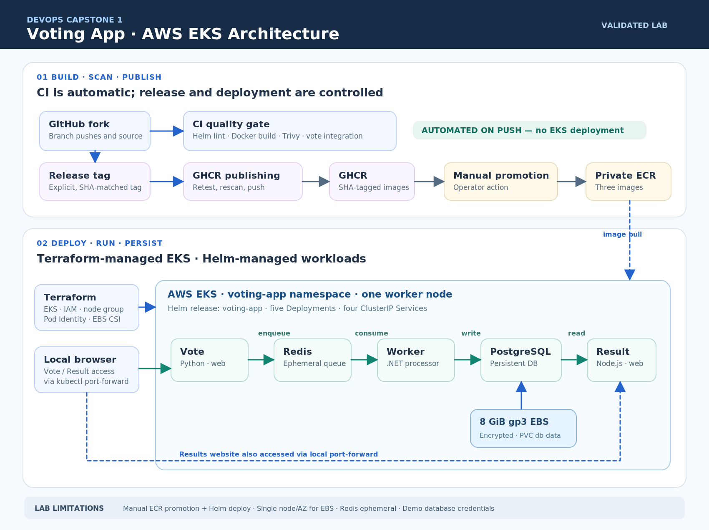
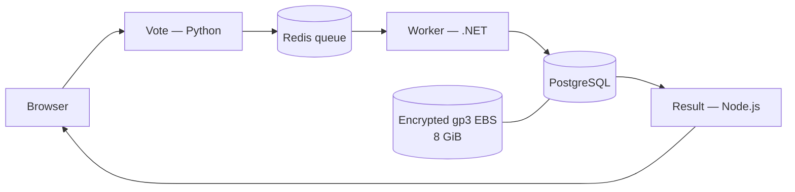
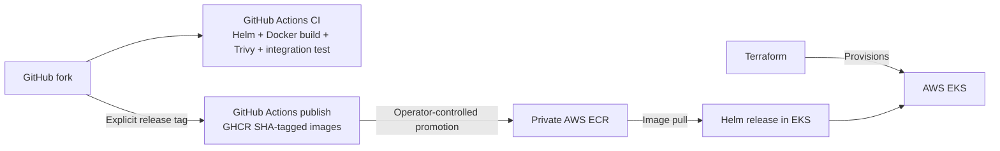

# DevOps Capstone 1 — Example Voting App on AWS EKS

[](https://github.com/KayceeJayy/example-voting-app/actions/workflows/capstone-ci.yaml)

This repository is a DevOps capstone based on the [Docker Samples example voting app](https://github.com/dockersamples/example-voting-app). The objective is to take a five-service application from local Docker Compose to hardened containers, automated quality checks, AWS infrastructure as code, an EKS/Helm deployment, and a demonstrated rollback.

- **Working branch:** `feature/container-hardening`
- **Cloud region:** `eu-north-1` (Stockholm)
- **Cluster:** `devops-capstone-eks`
- **Current Helm release / namespace:** `voting-app` / `voting-app`

**Intended use:** Training/lab only, **not production**.

## Architecture and data flow





- **Vote:** receives a visitor's choice and queues it in Redis.
- **Redis:** an in-memory queue; its Helm volume is ephemeral (`emptyDir`).
- **Worker:** reads queued votes and writes records to PostgreSQL.
- **PostgreSQL:** stores votes on an encrypted 8 GiB EBS volume mounted through a gp3 PersistentVolumeClaim.
- **Result:** queries PostgreSQL and displays the current totals.

The five services run as Kubernetes Deployments. The chart exposes `vote`, `result`, `redis` and `db` as internal `ClusterIP` Services; access to the two websites is via local port forwarding, not a public LoadBalancer.

### Build and delivery flow



**Automation boundary:** a branch push runs the CI quality gate, but does **not** automatically publish images to ECR or deploy to EKS. GHCR publishing requires a deliberately pushed tag; promotion to ECR and Helm deployment are separate operator actions. Full automatic deployment on every push is **not yet implemented** and remains a capstone acceptance item to review.

## Repository layout

| Path | Purpose |
| --- | --- |
| `vote/`, `result/`, `worker/` | Application services and hardened Dockerfiles |
| `docker-compose.yml` | Local development stack |
| `ci/docker-compose.ci.yml` | Disposable integration-test environment |
| `.github/workflows/capstone-ci.yaml` | Automated Helm validation, builds, scans and integration test |
| `.github/workflows/capstone-publish-ghcr.yaml` | Tag-triggered, gated GHCR publication |
| `infra/eks/` | AWS EKS, node group, IAM and EBS CSI add-ons in Terraform |
| `helm/voting-app/` | Five-service Helm chart and PostgreSQL PVC |
| `k8s-specifications/storageclass-gp3.yaml` | Encrypted gp3 EBS StorageClass with `Retain` policy |
| `scripts/` | Chart validation, integration tests and guarded ECR publishing |
| `docs/` | Architecture notes, security report, workflows and test evidence |

## Prerequisites

For local testing: Git, Docker Engine with the Compose plugin, and a browser. For Kubernetes deployment: Helm, `kubectl`, Terraform, AWS CLI v2, an authorized AWS IAM Identity Center (SSO) profile, existing VPC/subnets, and adequate AWS permissions and budget.

The commands below assume a Linux shell and that you are in the repository root. **Never commit AWS credentials, kubeconfig files, Terraform state, real passwords, or local deployment overrides.**

## 1. Run locally with Docker Compose

```bash
git clone https://github.com/KayceeJayy/example-voting-app.git
cd example-voting-app
git checkout feature/container-hardening

docker compose up -d --build
docker compose ps
```

Open **Vote:** http://localhost:8080 and **Result:** http://localhost:8081. Cast a vote, then confirm that the Result page updates. The local Compose stack uses a Docker-managed PostgreSQL volume; its storage is separate from the EKS/EBS volume.

```bash
docker compose logs --tail=80
docker compose down
```

Do **not** add `--volumes` unless you intend to delete local database data.

## 2. Container hardening and automated tests

The three custom production images (Vote, Worker, Result) were hardened using non-root execution, pinned production base images, reduced dependencies and runtime footprints. The Results production build is multi-stage. See [the security report](docs/security/SECURITY_REPORT.md) for remediation details and dated Trivy evidence.

The reported final application-image scans on **12 November 2026** had **zero HIGH and zero CRITICAL findings at scan time**. Vulnerability results may change as new advisories are published; Redis and PostgreSQL images require separate review.

The push-triggered CI workflow (`capstone-ci.yaml`) performs:

1. Strict Helm lint/render validation.
2. Three AMD64 production image builds.
3. Trivy HIGH/CRITICAL vulnerability gates on each custom image.
4. A disposable five-service Compose integration test, including a real vote written to PostgreSQL.
5. Environment cleanup even after a test failure.

Run the chart and integration checks locally if the production images are already built:

```bash
bash scripts/validate_voting_helm.sh
# To build the production images if they do not already exist:
for service in vote worker result; do
  docker build --platform linux/amd64 --target final \
    -t "${service}-secure:local" "./${service}"
done

docker compose -f ci/docker-compose.ci.yml up -d --no-build
bash scripts/test_voting_compose_ci.sh
docker compose -f ci/docker-compose.ci.yml down --volumes --remove-orphans
```

The CI environment binds web ports `18080` and `18081` locally. Its volumes are disposable, unlike the EKS PostgreSQL PVC.

## 3. Provision and manage EKS with Terraform

Terraform defines the EKS cluster, managed node group, IAM roles, EKS Pod Identity Agent and AWS EBS CSI Driver. The configuration uses existing public subnets in the account's default VPC; it does **not** create a new VPC.

**AWS resources incur charges while running.** Before applying, review IAM access, the active account/region, the cost budget and the exact plan. EKS control plane, worker EC2, root disks, public IPv4 and EBS may all be billable.

```bash
export AWS_PROFILE=terraform-process
export AWS_REGION=eu-north-1

test -e infra/eks/terraform.tfvars || \
  cp infra/eks/terraform.tfvars.example infra/eks/terraform.tfvars
# Edit the ignored terraform.tfvars for YOUR account/VPC/subnets,
# node size and CURRENT public IPv4/32.

terraform -chdir=infra/eks init
terraform -chdir=infra/eks fmt -check -recursive
terraform -chdir=infra/eks validate
terraform -chdir=infra/eks plan
# Review ALL proposed changes before deciding whether to apply.
terraform -chdir=infra/eks apply
```

The public EKS API endpoint is restricted to the operator's current IPv4 `/32`; private endpoint access is also enabled. If your ISP changes the IP, update the **ignored** `terraform.tfvars`, review a new plan and apply only the intended endpoint change. Never open the API to `0.0.0.0/0` as a workaround.

After provisioning:

```bash
aws eks update-kubeconfig --name devops-capstone-eks \
  --region eu-north-1 --profile terraform-process
kubectl get nodes
kubectl get pods -n kube-system
```

A previous Terraform teardown and subsequent cluster recreation have been demonstrated; evidence is stored under `docs/evidence/eks/`.

## 4. Configure PostgreSQL storage and deploy with Helm

The Terraform EBS CSI add-on and Pod Identity role must be operational before provisioning the volume. The `gp3` StorageClass is a separate Kubernetes manifest and must exist before the Helm install.

```bash
kubectl apply -f k8s-specifications/storageclass-gp3.yaml
kubectl get storageclass gp3
```

The chart's default application image repositories are intentionally invalid placeholders. Deploy **only with valid, verified images** using a local override such as `helm/voting-app/values-ecr.local.yaml` (Git-ignored). The example deployment used manually promoted, SHA-tagged images in private ECR.

```bash
helm lint ./helm/voting-app
helm template voting-app ./helm/voting-app -n voting-app \
  -f helm/voting-app/values-ecr.local.yaml > /tmp/voting-app-rendered.yaml

helm upgrade --install voting-app ./helm/voting-app \
  --namespace voting-app --create-namespace \
  -f helm/voting-app/values-ecr.local.yaml \
  --wait --timeout 8m

helm status voting-app -n voting-app
kubectl get deployments,pods,svc -n voting-app
kubectl get pvc db-data -n voting-app
```

Expected: five available Deployments; `db-data` PVC **Bound** to an **8 GiB, RWO, gp3** PV. PostgreSQL has a persistent EBS volume; **Redis remains ephemeral**. The gp3 StorageClass has a `Retain` reclaim policy, so deleting a claim or the cluster may **not** remove its underlying billable EBS volume.

### Access the websites

In two terminals:

```bash
kubectl -n voting-app port-forward svc/vote 18080:8080
# Run separately:
kubectl -n voting-app port-forward svc/result 18081:8080
```

Open http://127.0.0.1:18080 and http://127.0.0.1:18081. Verify that a newly cast vote appears in Result. Port forwarding requires working `kubectl` access; it does not expose these applications publicly.

### Persistence verification

On **15 November 2026**, an actual PostgreSQL test record was inserted, the database Pod was deliberately deleted, and the record was recovered from the replacement Pod. AWS inspection confirmed an encrypted, in-use **gp3 8 GiB** EBS volume. See [persistence evidence](docs/evidence/eks/postgres-persistence-2026-11-15.txt).

This demonstrates **Pod-replacement persistence**, not multi-AZ failover, point-in-time backup, or disaster recovery. Worker and Result each restarted once during database termination (`SQLSTATE 57P01`) and recovered under Kubernetes; graceful reconnect behavior is not implemented.

## 5. Release publishing and rollback

**GHCR publication is opt-in.** After a reviewed commit, an annotated tag of the form `capstone-publish-<12-character-commit-SHA>` triggers `.github/workflows/capstone-publish-ghcr.yaml`. It rebuilds, rescans and integration-tests before pushing immutable-commit-*named* images to GHCR; GHCR tag immutability itself is not enforced.

```bash
TAG="capstone-publish-$(git rev-parse --short=12 HEAD)"
git tag -a "$TAG" -m "Publish scanned capstone images"
git push origin "$TAG"
```

Only run this when intentionally creating a new publication tag. No additional long-lived GitHub secret is required for GHCR: publishing uses the workflow-scoped `GITHUB_TOKEN`. AWS ECR publication is handled separately using an authenticated **local** AWS CLI profile, not GitHub-stored AWS credentials. See [GHCR workflow notes](docs/ci/GHCR_PHASE_2.md) and [promotion evidence](docs/evidence/ci/ghcr-to-ecr-promotion-2026-11-13.txt).

A **deliberately failing Helm revision and successful manual rollback** were demonstrated on **13 November 2026**, with release history and recovered workloads recorded in [Helm rollback evidence](docs/evidence/helm/revision-3-rollback-2026-11-13.txt). This evidence is from an earlier release/cluster and is distinct from the current `voting-app` release. For a future rollback, first inspect the current release history and choose a known-good revision:

```bash
helm history voting-app -n voting-app
# After reviewing the revision and knowing its effects:
# helm rollback voting-app <KNOWN_GOOD_REVISION> -n voting-app --wait
```

**Do not** blindly repeat the intentional failure exercise against a working database.

## Evidence and related documentation

- [Container security report and Trivy results](docs/security/SECURITY_REPORT.md)
- [CI pipeline explanation](docs/ci/CI_PHASE_1.md)
- [GHCR publishing workflow](docs/ci/GHCR_PHASE_2.md)
- [Successful CI screenshot](docs/evidence/ci/Voting%20App%20Github%20Actions.png)
- [GHCR-to-ECR promotion](docs/evidence/ci/ghcr-to-ecr-promotion-2026-11-13.txt)
- [EKS teardown proof](docs/evidence/eks/eks-teardown-2026-11-13.txt)
- [Helm failure and rollback proof](docs/evidence/helm/revision-3-rollback-2026-11-13.txt)
- [Encrypted EBS/PostgreSQL persistence proof](docs/evidence/eks/postgres-persistence-2026-11-15.txt)
- Voting screenshots: [`docs/evidence/`](docs/evidence/), [`docs/evidence/helm/`](docs/evidence/helm/)

The legacy `architecture.excalidraw.png` belongs to the original example application; the Mermaid diagrams above describe the **current** Kubernetes/runtime and delivery paths. The updated architecture diagram is available at `docs/architecture/capstone-architecture.png`, with an editable SVG version alongside it.

## Security limitations and cleanup

- **Lab credentials:** the upstream Worker/Result code hardcodes `postgres/postgres`. The Helm Secret does not eliminate that hardcoded credential. Do not use this deployment for production or publicly expose database services.
- **Availability:** one EC2 worker node and a single-AZ EBS volume do not provide high availability; ephemeral Redis data can be lost on Pod replacement.
- **Recovery:** application containers rely on Kubernetes restarts when PostgreSQL disconnects; the Result app can query before the Worker creates the `votes` table on initial startup.
- **CI/CD gap:** the current pipeline validates automatically, but EKS deployment is not triggered by ordinary pushes. An approved secure deployment route is needed for full automation. Hosted GitHub runners cannot normally access the narrowly allowlisted public EKS API endpoint.
- **Cleanup:** stop using chargeable AWS resources when the lab is complete. Before `terraform destroy`, inventory persistent volumes and retained EBS disks; a `Retain` volume can survive deletion and continue billing. The private ECR repositories are **not** managed by this EKS Terraform stack and also require separate review/cleanup. Before destruction, plan and inspect carefully:

  ```bash
  terraform -chdir=infra/eks plan -destroy
  # ONLY after reviewing consequences, retained EBS resources and costs:
  # terraform -chdir=infra/eks destroy
  # aws eks list-clusters --region eu-north-1 --profile terraform-process
  ```

- **Secrets:** `infra/eks/terraform.tfvars`, Terraform state, and `helm/voting-app/values-ecr.local.yaml` are Git-ignored. Verify `git status` and staged contents before every commit.

## Capstone status

**Demonstrated:** local voting, hardened custom images, CI quality gates, tag-gated GHCR publishing, manual ECR promotion, Terraform EKS provisioning/teardown and recreation, Helm installation/rollback, and encrypted PostgreSQL EBS persistence.

**Before final hand-in:** confirm the current EKS deployment processes a new vote end-to-end; verify no secrets are committed; and resolve or explicitly disclose the difference between current manual EKS deployment and the original requirement for push-to-deploy automation.

---

*Source project:* [dockersamples/example-voting-app](https://github.com/dockersamples/example-voting-app). *Capstone fork:* [KayceeJayy/example-voting-app](https://github.com/KayceeJayy/example-voting-app).
